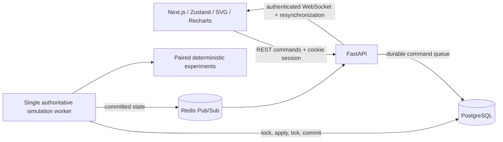

# FleetVerse

[](https://github.com/jeelthacker1/FleetVerse/actions/workflows/ci.yml)

**A real-time autonomous warehouse digital twin, fleet intelligence and incident simulation platform.**

FleetVerse is executable software: a Python worker computes robot movement, processes durable commands, persists simulation state and publishes updates. The browser renders that state. All activity and performance numbers are explicitly **simulated**, never real warehouse telemetry.

## Run the complete application

Install Docker Desktop with its Linux-container engine running. On Windows, Docker Desktop requires a working WSL 2 or Hyper-V backend.

```powershell
git clone https://github.com/jeelthacker1/FleetVerse.git
cd FleetVerse
docker compose up --build
```

Open [FleetVerse](http://localhost:3000), then **Open mission control**. The supplied Compose configuration explicitly enables local demo mode. Sign in as `admin`, `operator`, or `viewer`, with password `fleetverse-demo`. Services bind to loopback. Do not expose this development configuration to the Internet.

Migrations and three warehouse layouts are installed automatically. Create a simulation, generate orders, then press **Start**. The default fleet contains 20 robots. API documentation is at [localhost:8000/docs](http://localhost:8000/docs).

## What works

- Warehouse editor: racks, restricted cells, pickup/drop-off stations, chargers, ordered delivery checkpoints, one-way lanes, grid dimensions, validation, saved layout revisions and new warehouses.
- Authoritative worker: seeded workloads, deterministic ticks, task lifecycles, loading/unloading delays, battery use, charging, configurable fleets, pause/resume/stop/reset and speed control.
- Routing: A* in space-time, cell and edge reservations, safe waiting, rotating planning priority and conservative deadlock escape. Safety is enforced with occupancy and edge-swap assertions.
- Operations: server-derived metrics, robot telemetry, paths, task creation/assignment/cancellation, history and real failure injection with recovery actions.
- History: persisted events and exact state snapshots, incident filtering, scrubbing, speed-controlled recorded replay and recorded/live comparisons.
- Experiments: independent baseline and variant runs using equivalent seeded initial orders; configurable fleet, policy, charger availability, blockage, priority and additional arrivals; computed charts and CSV/JSON exports.
- Security: Argon2 passwords, expiring HTTP-only sessions, roles, CSRF checks, origin restrictions, authenticated WebSockets, command idempotency, validation, throttling and audit logs.
- Infrastructure: five Compose services, relational schema, Alembic migration, health checks, separate worker, dependency locks and CI with backend, build and browser acceptance checks.

## Architecture



The API never advances an existing run. The worker serializes commands using database row locks and acknowledges them only after applying or rejecting them. Pub/Sub loss is recovered from the database. A disconnected browser reconnects and receives the latest revision.

## Repository map

| Directory | Purpose |
| --- | --- |
| `backend/app/engine.py` | Pure deterministic routing, dispatch, simulation and experiments |
| `backend/app/main.py` | Versioned REST API, authentication, authorization and WebSockets |
| `backend/app/worker.py` | Durable commands, simulation ticks, persistence and publication |
| `backend/app/db.py` | Relational models |
| `backend/migrations` | Alembic schema migrations |
| `backend/tests` | Safety, determinism, persistence, security and concurrency tests |
| `web/app` | Landing page, mission control and operation tools |
| `web/components` | SVG warehouse map and shadcn-style Radix button |
| `web/tests` | Playwright acceptance workflow |
| `.github/workflows/ci.yml` | Lint, tests, production build and Compose integration |

## Development and evidence

See [setup](docs/SETUP.md), [algorithms](docs/ALGORITHMS.md), [schema and retention](docs/DATABASE.md), [API](docs/API.md), [demo scripts](docs/DEMO.md), [validation and benchmarks](docs/VALIDATION.md), and [limitations](docs/LIMITATIONS.md).

```powershell
cd backend
python -m venv .venv
.\.venv\Scripts\Activate.ps1
pip install -r requirements.lock
ruff check .
pytest -q -s
cd ../web
npm ci
npm run typecheck
npm run build
# With the application running:
npx playwright install chromium
npm run test:e2e
```

No paid services or LLM key are required. Optional 3D and LLM summaries are intentionally deferred. MIT licensed.
